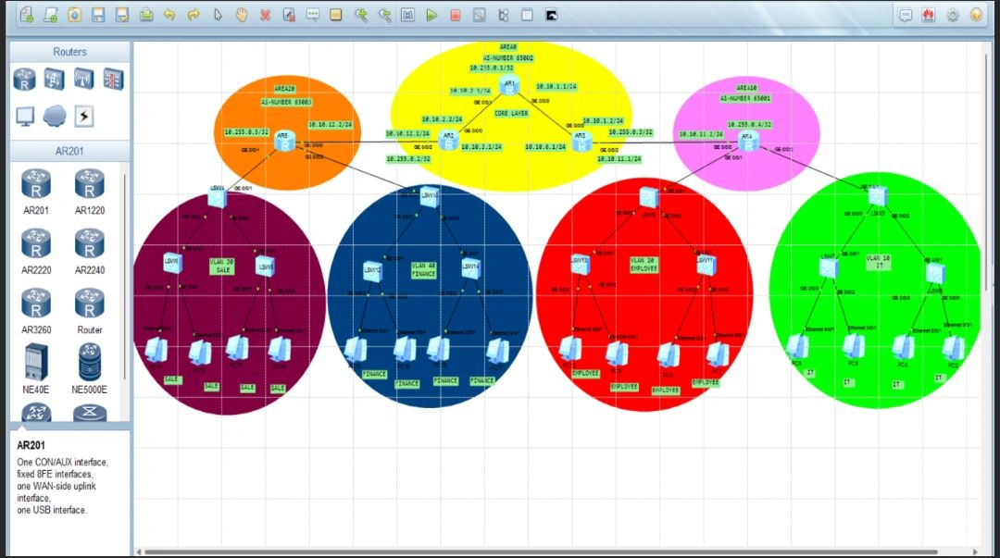

# Secure Multisite BGP/MPLS Backbone with VPN Services

Graduation project of the Digital Egypt Pioneers Initiative (DEPI), Huawei Networking Administrator track: design and implementation of a secure, scalable and resilient multisite backbone connecting multiple data centers and branch sites.

## What it does

Simulates a real enterprise / service-provider environment where multiple customers share the same backbone while keeping full traffic isolation using MPLS Layer 3 VPNs.

### Network architecture

- Core/backbone: MPLS-enabled routers running OSPF and MPLS LDP.
- Provider Edge (PE): VRFs configured per customer.
- Customer Edge (CE): connected using BGP to exchange routes.
- Logical separation between customers using VPN routing and forwarding tables.

### Protocols and technologies

- OSPF as the IGP for fast convergence.
- BGP for exchanging VPN routes between PE routers.
- MPLS and LDP for label distribution across the backbone.
- MPLS Layer 3 VPN for scalability and traffic isolation.
- SNMP and logging for monitoring and basic network management.
- Implemented and tested in the Huawei eNSP simulator.

### Security and performance focus

- Complete traffic isolation between different VPN customers.
- Optimized routing paths for efficient bandwidth utilization.
- Scalable design allowing new sites or customers to be added easily.
- Cost-efficient architecture using standard routing technologies.

### Verification and testing

- End-to-end connectivity testing between branch sites.
- Verification of MPLS labels and VPN routes.
- Route validation using OSPF and BGP verification commands.
- Confirmed correct VRF separation and traffic isolation.

## Role

Designed and implemented the backbone with the project team: architecture, protocol configuration, security policies, verification and technical documentation.

## Context

- Digital Egypt Pioneers Initiative (DEPI) - Huawei Networking Administrator track (2025).
- Related certifications: HCIA-Datacom (score 910/1000), Huawei Network Administrator (DEPI).

## Links

- Project post: https://www.linkedin.com/posts/aya-mubarak-829862298_digitalegyptpioneers-depi-huawei-activity-7407503246447226880-MGri

## Status

README upgrade for the existing repo (suggested rename: `secure-multisite-mpls-l3vpn-backbone`); eNSP topology files and configuration exports can be added later.
